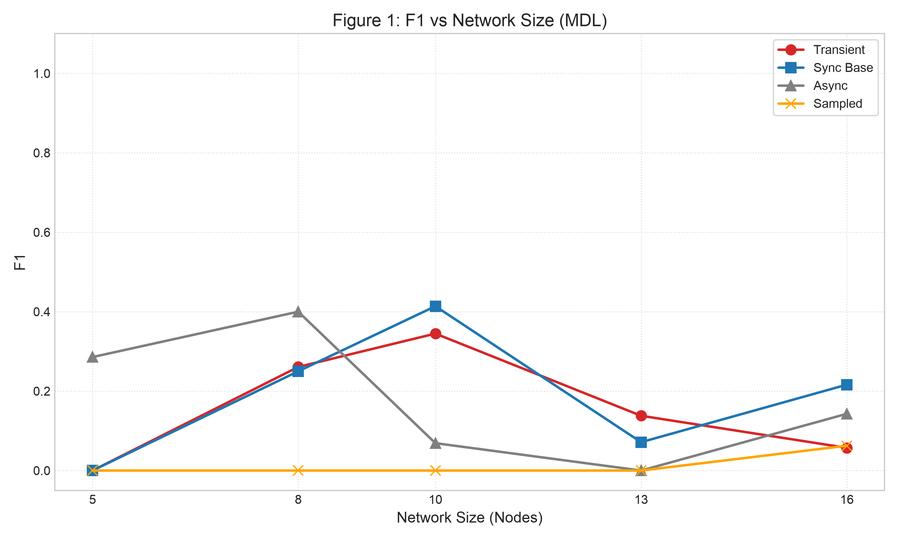
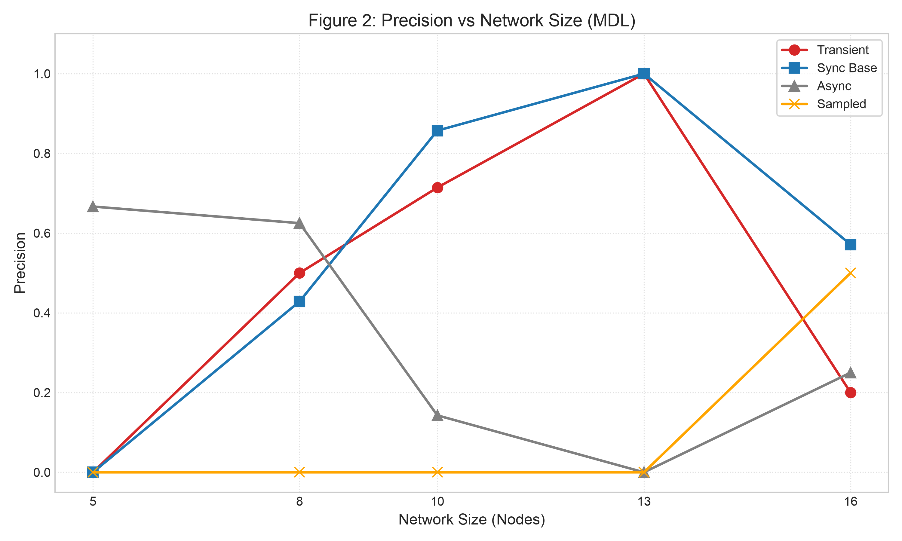
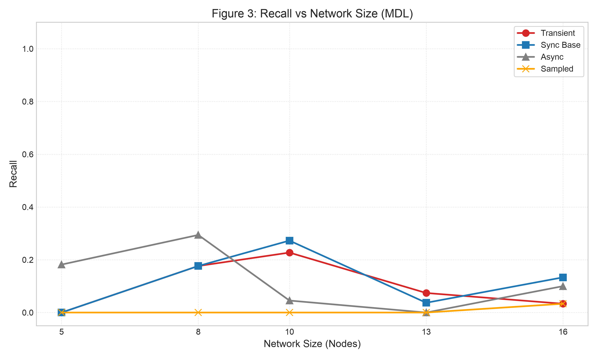
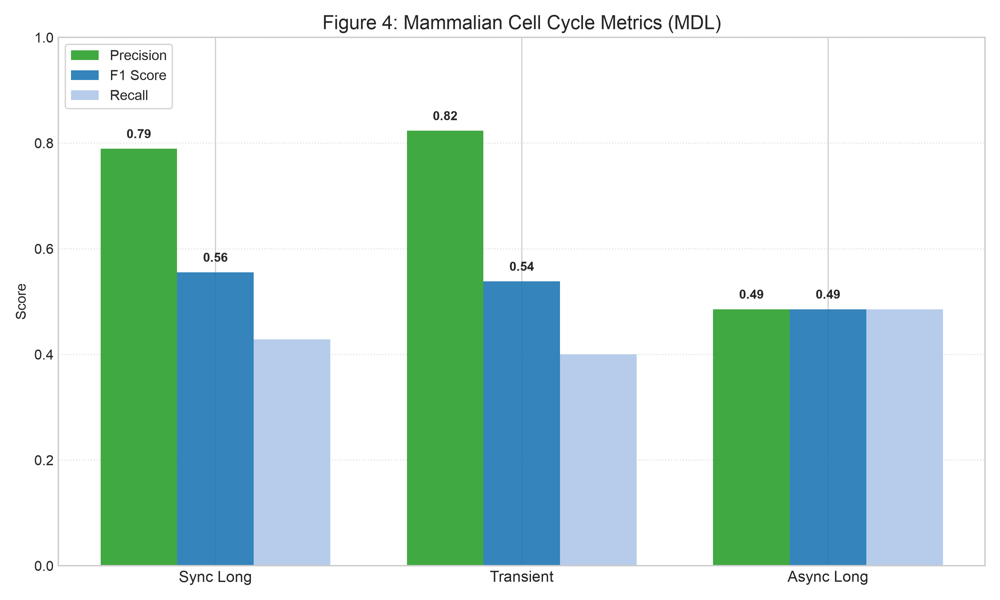
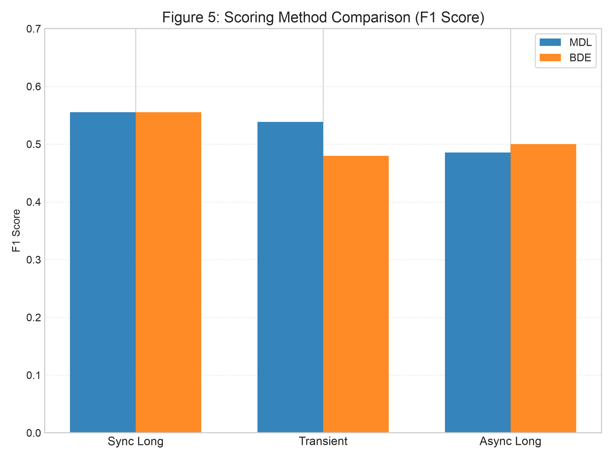

# Reverse-Engineering Gene Regulatory Networks using DBNs


-lightgrey.svg)


## 1. Overview

This repository contains a computational study evaluating the efficacy of **Dynamic Bayesian Networks (DBNs)** in reconstructing **Gene Regulatory Networks (GRNs)** from discrete time-series expression data. Using the exact structure-learning algorithm implemented in **BNFinder2**, this project investigates how network topology, update dynamics, and temporal sampling resolution affect graph recovery.

The experimental pipeline is divided into two phases:

1. **Synthetic Topology Benchmark (`src/run_synthetic.py`):** Systematic generation and simulation of Random Boolean Networks (RBNs) across increasing scales ($N \in \{5, 8, 10, 13, 16\}$ nodes, in-degree $k \in \{1, 2, 3\}$). Time-series trajectories are simulated under four distinct regimes:
   * **Synchronous (`sync_base`):** Deterministic simultaneous state transitions across all nodes ($T = 100$, sampling interval $\Delta t = 1$).
   * **Asynchronous (`async`):** Stochastic single-node updates per time step, modeling asynchronous biological update dynamics ($T = 200, \Delta t = 1$).
   * **Sub-sampled (`sampled`):** Synchronous updates recorded every 3rd step ($T = 150, \Delta t = 3$), testing causal signal degradation under low temporal resolution.
   * **Transient (`transient`):** Short synchronous bursts ($T = 20, \Delta t = 1$) capturing pre-attractor dynamic transitions.
2. **Biological Network Reconstruction (`src/run_biological.py`):** Validation on the 10-node **Mammalian Cell Cycle** network compiled from Boolean rules (`data/raw/model.bnet`) into exact truth tables. To ensure sufficient transition coverage, 5 independent trajectories are concatenated per regime (`sync_long`, `transient_bursts`, `async_long`) and evaluated under both Minimum Description Length (**MDL**) and Bayesian-Dirichlet Equivalence (**BDE**) scoring criteria.

---

## 2. Mathematical Formulation

### 2.1 Dynamic Bayesian Networks (DBNs)
Let $\mathbf{X}^{(t)} = (X_1^{(t)}, X_2^{(t)}, \dots, X_n^{(t)}) \in \{0, 1\}^n$ denote the binary gene expression state vector at discrete time $t \in \{1, \dots, T\}$. Assuming a first-order Markov process where regulatory interactions occur strictly across consecutive time steps ($t \to t+1$), the joint transition probability factorizes over a bipartite Directed Acyclic Graph (DAG) $\mathcal{G} = (\mathcal{V}, \mathcal{E})$:

$$P(\mathbf{X}^{(t+1)} \mid \mathbf{X}^{(t)}, \mathcal{G}, \Theta) = \prod_{i=1}^{n} P\left(X_i^{(t+1)} \mid \mathbf{Pa}_i^{(t)}, \theta_i\right)$$

where $\mathbf{Pa}_i^{(t)} \subseteq \mathbf{X}^{(t)}$ represents the set of parent regulators of node $X_i$, and $\theta_i$ parameterizes the local conditional probability distribution (CPD). Because edges are restricted to point from slice $t$ to slice $t+1$, the unrolled transition graph is inherently acyclic, allowing exact polynomial-time parent set identification independently for each node $X_i$.

### 2.2 Minimum Description Length (MDL) Scoring
Given a dataset $\mathcal{D}$ of $N$ observed state transitions, structure learning seeks an optimal graph $\mathcal{G}^*$ that minimizes the decomposable score:

$$\mathcal{G}^* = \arg\min_{\mathcal{G}} \text{Score}_{\text{MDL}}(\mathcal{G} : \mathcal{D}) = \arg\min_{\mathcal{G}} \sum_{i=1}^{n} \text{MDL}(X_i, \mathbf{Pa}_i : \mathcal{D})$$

The local MDL score balances empirical negative log-likelihood against model complexity (penalizing dense parent configurations to suppress false positives on noisy transitions):

$$\text{MDL}(X_i, \mathbf{Pa}_i : \mathcal{D}) = -\sum_{j=1}^{q_i} \sum_{k \in \{0,1\}} N_{ijk} \log_2 \left( \frac{N_{ijk}}{N_{ij}} \right) + \frac{\log_2 N}{2} q_i (r_i - 1)$$

where $r_i = 2$ is the binary state cardinality, $q_i = 2^{\vert{}\mathbf{Pa}_i\vert{}}$ is the number of parent configurations (truth table rows), $N_{ij}$ is the sample count of parent configuration $j$ in $\mathcal{D}$, and $N_{ijk}$ is the count of transitions where parent configuration $j$ leads to child state $X_i^{(t+1)} = k$.

### 2.3 Structural Evaluation Metrics
Given the ground-truth edge set $\mathcal{E}_{\text{true}}$ and inferred edge set $\mathcal{E}_{\text{inf}}$, graph recovery is quantified via edge-level Precision, Recall, $F_1$-score, and Structural Hamming Distance ($\text{SHD}$):

$$\text{Precision} = \frac{\vert{}\mathcal{E}_{\text{true}} \cap \mathcal{E}_{\text{inf}}\vert{}}{\vert{}\mathcal{E}_{\text{inf}}\vert{}}, \quad \text{Recall} = \frac{\vert{}\mathcal{E}_{\text{true}} \cap \mathcal{E}_{\text{inf}}\vert{}}{\vert{}\mathcal{E}_{\text{true}}\vert{}}, \quad F_1 = \frac{2 \cdot \text{Precision} \cdot \text{Recall}}{\text{Precision} + \text{Recall}}$$

$$\text{SHD}(\mathcal{E}_{\text{true}}, \mathcal{E}_{\text{inf}}) = \vert{}\mathcal{E}_{\text{inf}} \setminus \mathcal{E}_{\text{true}}\vert{} + \vert{}\mathcal{E}_{\text{true}} \setminus \mathcal{E}_{\text{inf}}\vert{} = \text{FP} + \text{FN}$$

---

## 3. Empirical Results & Visualizations

### 3.1 Part I: Synthetic RBN Benchmark ($N \in [5, 16]$)
Across synthetic networks, **Recall** serves as the primary bottleneck as the candidate parent space expands, whereas `sync_base` and `transient` trajectories maintain high **Precision** (up to $0.86$ at $N = 10$ and $1.00$ at $N = 13$), ensuring that inferred regulatory edges contain minimal false positives. Sub-sampling ($\Delta t = 3$) severely degrades causal inference ($F_1 = 0.00$ for $N \in \{5, 8, 10, 13\}$) due to aliasing of multi-step transitions.





### 3.2 Part II: Mammalian Cell Cycle Reconstruction ($N = 10$)
On the 10-node biological topology (35 ground-truth edges), DBN inference achieves substantially higher reconstruction accuracy than on random networks of identical size ($F_1 = 0.56$ vs. $F_1 = 0.41$ on synthetic $N = 10$). Furthermore, **MDL** consistently matches or outperforms **BDE** in structural accuracy ($\text{SHD}$) by penalizing spurious edges:

| Dataset Scenario | Scoring Method | Precision | Recall | $F_1$ Score | Hamming Distance ($\text{SHD}$) |
| :--- | :--- | :--- | :--- | :--- | :--- |
| `sync_long` ($5 \times 100$ steps) | **MDL** | 0.79 | 0.43 | **0.56** | **24** |
| `sync_long` ($5 \times 100$ steps) | **BDE** | 0.79 | 0.43 | **0.56** | **24** |
| `transient_bursts` ($5 \times 20$ steps) | **MDL** | **0.82** | 0.40 | 0.54 | **24** |
| `transient_bursts` ($5 \times 20$ steps) | **BDE** | 0.80 | 0.34 | 0.48 | 26 |
| `async_long` ($5 \times 200$ steps) | **MDL** | 0.49 | 0.49 | 0.49 | 36 |
| `async_long` ($5 \times 200$ steps) | **BDE** | 0.43 | **0.60** | 0.50 | 42 |




---

## 4. Engineering & Architecture

### Multi-Runtime Inter-Process Architecture (Python 3 $\leftrightarrow$ Legacy Python 2.7)
A frequent challenge in computational biology is integrating established, mathematically exact legacy solvers into modern analysis pipelines. **BNFinder2** strictly requires a legacy **Python 2.7** runtime, whereas the simulation engine, `.bnet` parser, and statistical evaluation modules are written in strictly typed **Python 3.12+**.

To decouple the runtimes without containerization overhead, the pipeline implements a cross-environment orchestration pattern:
1. **Isolated Dual Environments:** The host pipeline runs in a modern Python 3 environment (`.venv`) managed by `uv`, while `bnf` and its legacy dependencies are encapsulated inside a dedicated Python 2.7 virtual environment (`.venv_legacy/bin/bnf`).
2. **Subprocess Orchestration & Serialization:** `src/data/io.py` serializes simulated trajectories into transposed tab-delimited matrices (`Rows = Genes`, `Columns = Series:TimeStep`), and `src/inference/bnfinder.py` invokes `.venv_legacy/bin/bnf` via `subprocess.run` with isolated `stdout`/`stderr` pipes.
3. **Safe AST Deserialization:** BNFinder outputs learned conditional probability distributions in `.cpd` format (serialized Python dictionary literals). `src/utils/metrics.py` safely parses these artifacts back into memory using `ast.literal_eval` to extract parent sets (`pars`) and compute structural metrics.

### Project Structure
```text
├── assets/                     # Publication-grade evaluation plots (.png)
├── data/
│   ├── raw/model.bnet          # Boolean rules for the Mammalian Cell Cycle network
│   ├── networks/               # Ground-truth topologies and truth tables (.json)
│   ├── datasets/               # Transposed time-series expression matrices (.txt)
│   └── results/                # Inferred structures (.cpd) and aggregated metrics (.csv)
├── docs/
│   └── report.pdf              # Full academic report and theoretical analysis
├── src/
│   ├── config.py               # Centralized path configuration and constants
│   ├── networks/               # RBN generator (rbn.py) and .bnet compiler (bnet_parser.py)
│   ├── data/                   # Unified dynamical simulator (simulator.py) and I/O (io.py)
│   ├── inference/              # Subprocess bridge to Python 2.7 BNFinder2 (bnfinder.py)
│   ├── utils/                  # Graph distance and classification metrics (metrics.py)
│   ├── run_synthetic.py        # Entry point: Part I Synthetic RBN benchmark
│   ├── run_biological.py       # Entry point: Part II Mammalian Cell Cycle reconstruction
│   └── plot_results.py         # Entry point: Visualization generator from CSV artifacts
├── Makefile                    # Automation for environment setup, linting, and execution
└── pyproject.toml              # Project metadata, dependencies (uv), Ruff, and Mypy config
```

---

## 5. Usage

The project uses `uv` for dependency management and `Makefile` for workflow automation.

```bash
# 1. Clone the repository and initialize both Python 3 (.venv) and Python 2.7 (.venv_legacy)
git clone https://github.com/Pavelpuff/dbn-grn-inference.git
cd dbn-grn-inference
make setup
make setup-legacy

# 2. Run Part I (Synthetic RBN benchmark) and save metrics to data/results/part1_metrics.csv
make synthetic

# 3. Run Part II (Mammalian Cell Cycle) and save metrics to data/results/part2_metrics.csv
make biological

# 4. Generate evaluation figures in assets/
make plots

# Or run the entire pipeline (synthetic + biological + plots) in a single command:
make all
```